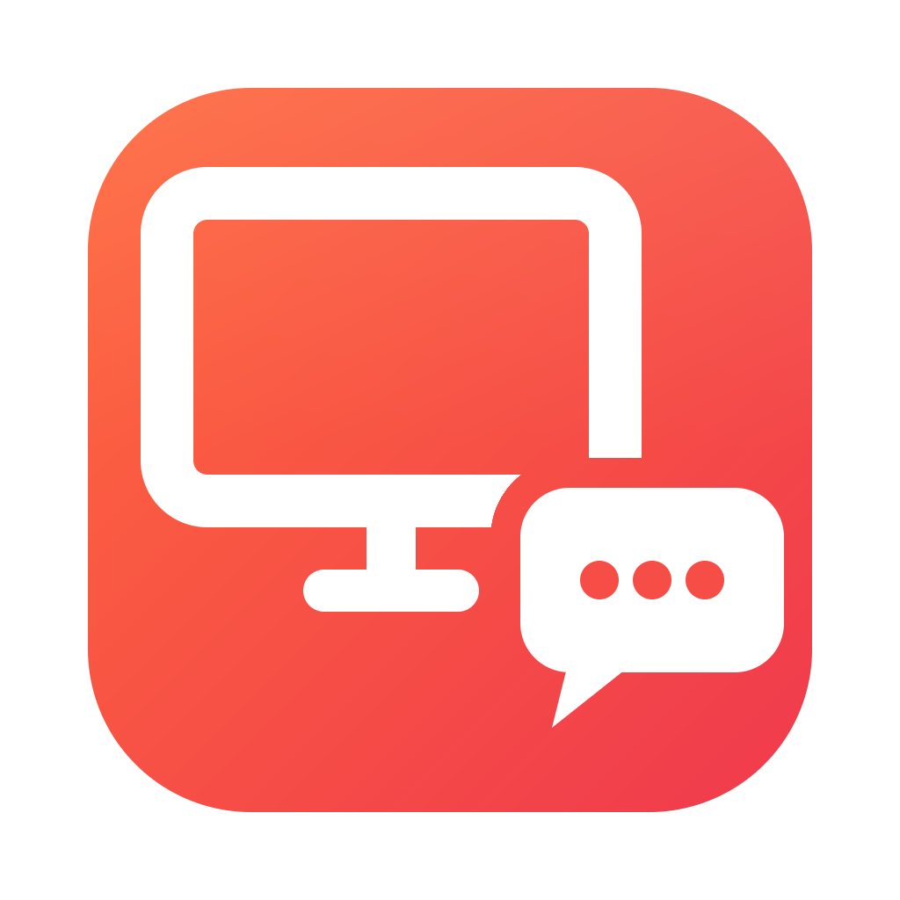
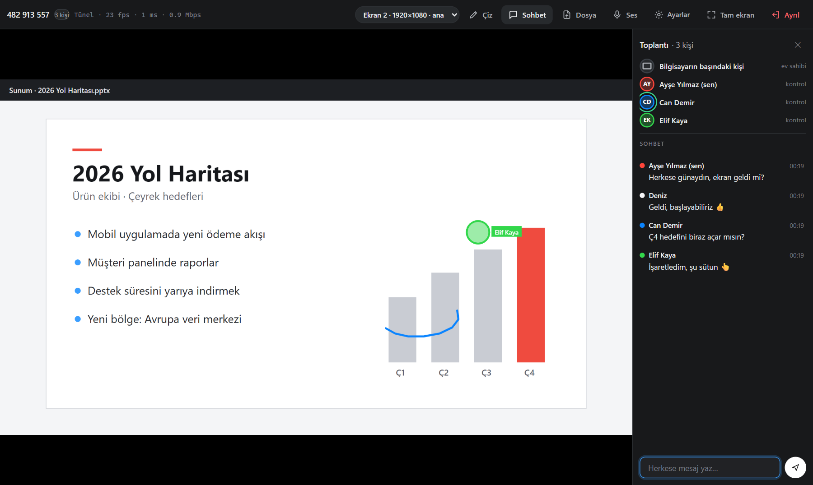
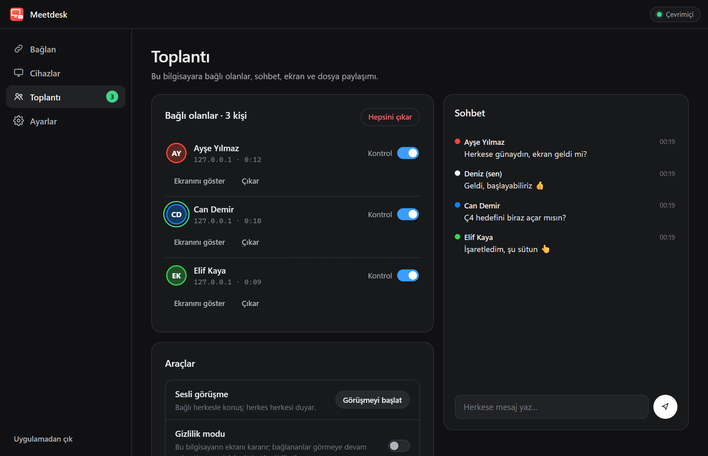
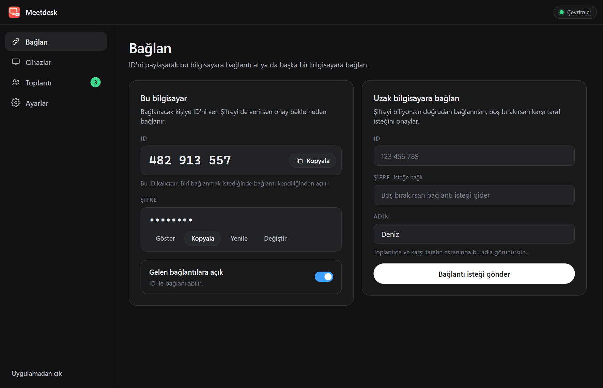
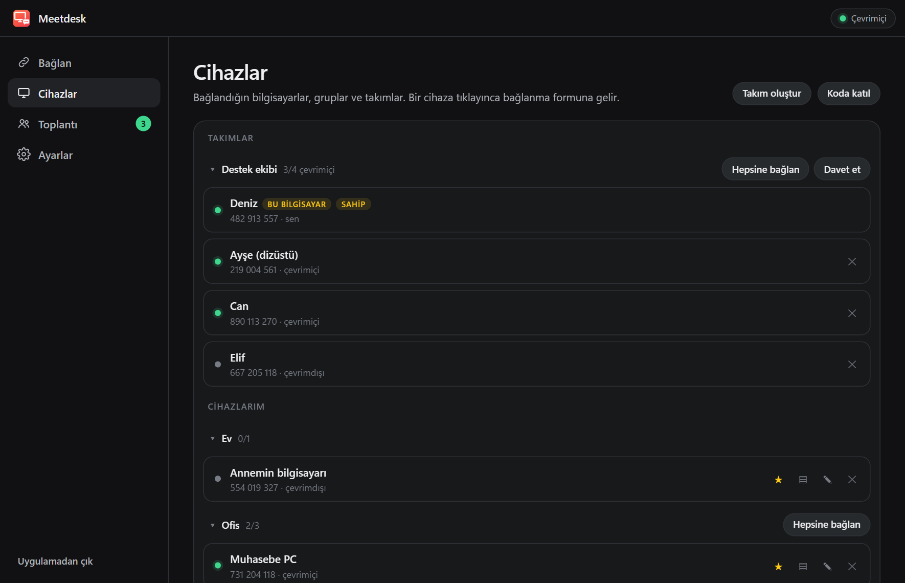
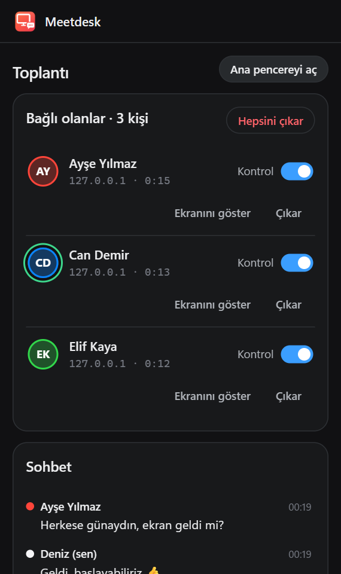
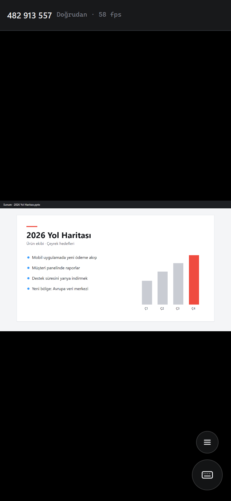

# Meetdesk

Go ile yazılmış uzaktan erişim ve toplantı aracı (Windows ve macOS); eski adı RemoteDesk. Bilgisayarlar mümkünse **doğrudan** (WebRTC) bağlanır; ağ engeli varsa Cloudflare **quick tunnel** üzerinden. Hesap, domain ya da port açma gerekmez.

<p align="center"></p>

| Toplantı penceresi: çizim, işaret, sohbet | Toplantı sayfası: bağlı olanlar ve sohbet |
|---|---|
|  |  |
| **Bağlan:** ID ve şifre, uzak bilgisayara bağlanma | **Cihazlar:** takımlar ve gruplar |
|  |  |

<p align="center">
  
  &nbsp;&nbsp;
  
  <br><sub>Biri bağlanınca sağ altta açılan oturum paneli · Telefondan tarayıcıyla bağlanma</sub>
</p>

## Kullanım

`Meetdesk.exe`yi (macOS'ta `Meetdesk.app`) aç. Ana pencerede bu bilgisayarın **ID**'si ve tek kullanımlık **şifresi** görünür.

- **Bağlanmak:** Karşı tarafın ID'sini gir. Şifreyi biliyorsan doğrudan bağlanırsın. Şifre alanını boş bırakırsan karşı tarafa bir **bağlantı isteği** gider; onaylarsa bağlanırsın.
- **Gözetimsiz erişim:** Ayarlar > Sabit şifre. Bu şifreyle gelen kişi onay beklemeden bağlanır. Şifrenin kendisi saklanmaz, yalnızca PBKDF2 özeti tutulur.
- **Tarayıcıdan erişim** (isteğe bağlı, Ayarlar > Erişim): Bağlantı adresi telefon ya da başka bir bilgisayarın tarayıcısında açılabilir. Şifre sorulur; telefonda dokunmatik kontrol ve telefon klavyesi çalışır. Tarayıcı da uygulama gibi doğrudan (WebRTC) bağlanır, genelde bir saniye içinde; olmazsa aynı sayfada tünele geçer. Cihaz kapalıysa ya da tarayıcıdan erişim kapalıysa bu hemen söylenir.

## Özellikler

### Bağlantı
- **Kalıcı ID** (buluşma sunucusu ayarlıysa): 9 haneli numara ya da seçtiğin bir ad (ör. `ofis-pc`). Kayıtlı cihazlar, favoriler ve kimin çevrimiçi olduğu listede görünür.
- **Doğrudan bağlantı:**
  - Görüntü, klavye/fare ve ses WebRTC veri kanallarıyla iki bilgisayar arasında doğrudan akar.
  - Buluşma sunucusundan yalnızca tek bir el sıkışma mesajı geçer.
  - Kurulamazsa tünel (WebSocket) kullanılır.
  - İzleme penceresinin durum satırında hangisinin kullanıldığı yazar ("Doğrudan" / "Tünel").
- **Birden fazla bağlantı:** Her cihaz ayrı bir pencerede açılır, aralarında geçiş yapılabilir. Bir gruba ya da takıma **toplu bağlanılabilir**.

### Takımlar ve gruplar
- **Takım:** Cihazlar > Takım oluştur. Davet kodunu bilen bilgisayar takıma katılır. Takımdakiler birbirinin cihazlarını ve hangisinin açık olduğunu görür. Bağlanmak için yine şifre ya da onay gerekir. Takımın sahibi üye çıkarabilir, kodu yenileyebilir, takımı silebilir.
- **Grup:** Kendi cihaz listende her cihaza bir grup adı verebilirsin (ör. "Ofis", "Ev"). Liste gruplara ayrılır.

### Toplantı ve sunum
- **Çok kişili bağlantı:**
  - Aynı bilgisayara birden fazla kişi aynı anda bağlanabilir (varsayılan 10, en fazla 30; Ayarlar'dan seçilir).
  - Aynı monitörü izleyenler için ekran bir kez yakalanıp bir kez sıkıştırılır (tek ffmpeg), görüntü herkese dağıtılır. Bağlantısı yavaş olan kişi diğerlerini yavaşlatmaz: o kişi kare atlayıp bir sonraki anahtar kareden devam eder.
  - Her kişiye bir renk atanır.
  - Toplantı sayfasında bağlı olanlar listelenir; fare/klavye izni kişi başına kapatılabilir, her kişi ayrı ayrı çıkarılabilir.
- **Sohbet:**
  - Bağlı herkes ve bilgisayarın başındaki kişi ortak sohbet eder.
  - Sonradan katılan kişi geçmişi görür.
- **Ekrana çizim ve işaret etme:**
  - Kalem, lazer, 5 renk, geri al, hepsini sil.
  - **İşaret et** aracıyla dokunulan yerde, o kişinin renginde bir daire (kenarı tam renk, içi yarı saydam) hızlıca yanıp söner ve kaybolur.
  - Çizgiler ve işaretler herkeste ve bağlanılan bilgisayarın ekranında görünür.
  - Windows'ta bağlanılan bilgisayardaki katman ekran yakalamaya girmez, yani görüntüde iki kez çıkmaz.
- **Sunum:**
  - "Herkes benim monitörümü izlesin": sunan kişi monitör değiştirince herkesin görüntüsü de değişir.
  - "Ekranımı herkese göster": kendi bilgisayarını toplantıya açarsın. Toplantıdakiler tek kullanımlık bir toplantı anahtarıyla, onaysız ve yalnızca izleme izniyle bağlanır. Paylaşım bitince anahtar geçersiz olur.
  - Bilgisayarın başındaki kişi bağlı birinden ekranını göstermesini isteyebilir.
- **Gizlilik modu:**
  - Bağlanılan bilgisayarın ekranı kararır; bağlananlar görmeye ve çalışmaya devam eder.
  - Bilgisayarın başındaki kişi Ctrl+Alt+Shift+P ile kapatır.
- **Bağlananlardan gizle** (Windows):
  - Seçilen pencereler bağlananlara giden görüntüde çizgili koyu bir alanla karartılır; bilgisayarın başındaki kişi normal görür. Ör. toplantı sırasında WhatsApp'ta gezinirken.
  - Bir programın tümü, tek bir pencere (ör. Chrome'da açılan "WhatsApp Web") ya da başlığında bir kelime geçen bütün pencereler gizlenebilir.
  - Programın menüleri ve açılır pencereleri de gizlenir. Üstüne başka bir pencere gelirse o kısım normal görünür.
  - Toplantı > Araçlar > Pencere gizle ya da Ayarlar > Bağlananlardan gizlenenler. Liste kalıcıdır.
- **Dosya aktarımı:**
  - İki yönlü, sürükle-bırakla.
  - Alınan dosyalar İndirilenler/Meetdesk klasörüne kaydedilir.
  - Dosya alma Ayarlar'dan kapatılabilir.
- **Sesli görüşme:**
  - WebRTC ile, mikrofon izni ister.
  - Toplantıda bağlanılan bilgisayar herkesin sesini birleştirir, herkes herkesi duyar.
- **Oturum paneli:** Windows'ta biri bağlanınca ekranın sağ altında küçük bir panel açılır. Kişiler, Sohbet ve Araçlar sekmeleri vardır; okunmamış mesaj sayısı sekmede görünür. Saatin yanındaki simgeye tıklayınca açılır ve kapanır.

### Görüntü
- **Ekran yakalama:**
  - Windows'ta **DXGI Desktop Duplication**; aynı monitörü izleyenler tek kopyalamayı paylaşır. Kullanılamazsa GDI'a düşülür.
  - macOS'ta `CGDisplayStream`.
- **H.264 (ffmpeg):**
  - Donanım kodlayıcı sırayla denenir: NVENC → Quick Sync → AMF → x264 → Media Foundation; macOS'ta VideoToolbox → x264.
  - Uyarlamalı bit hızı: 1,5–20 Mbps arası, bağlantıya göre ayarlanır.
  - İzleyici WebCodecs ile çözer; desteklenmiyorsa JPEG karolar kullanılır.
- **Çoklu monitör, pano senkronu, tam ekran** (tam ekranda Win/Alt+Tab da karşıya gider).

### Telefon ve tablet
- **Dokunmatik kontrol:**
  - Dokun = tık, iki parmakla dokun = sağ tık, tek parmakla sürükle = sürükle-bırak.
  - İki parmakla kaydır = tekerlek, sıkıştır = yakınlaştır.
- **Telefon klavyesi:**
  - Sağ alttaki düğmeyle açılır; Türkçe karakterler dahil yazar.
  - Windows'ta bir yazı alanına dokununca Android'de kendiliğinden açılır.
  - iPhone klavyeyi yalnızca dokunuş anında açtırdığı için orada düğme kullanılır.

### Diğer
- **Bildirim alanı simgesi** (Windows):
  - Ana pencere kapanınca uygulama arka planda bağlantı almaya devam eder.
  - Simgeye sağ tıklayınca menü açılır.
- **Bilgisayar açılınca başlat:** Oturum açınca arka planda başlar.
- **Engellenen tıklama:** Bağlanan kişinin tıklaması uygulanmadıysa (ana kullanıcı fareyi kullanıyor ya da yalnızca izleme izni var) o noktada sönen bir halka görünür.
- **Aynı anda kullanım** (deneysel): Bağlanan kişi kendi hayalet imleciyle çalışır, ana kullanıcının imleci oynamaz. Kapalıyken ana kullanıcı fareye dokununca kontrol ona geçer ve uzaktaki kişinin imleci adıyla gösterilir.
- **UAC:** Windows'ta "Yönetici olarak yeniden başlat" ile UAC pencereleri de kontrol edilebilir. Güvenli masaüstü açıkken izleyiciye uyarı gösterilir.
- **Güncelleme:** GitHub sürümleri denetlenir, tek tıkla kurulur (SHA-256 doğrulamalı).

## Sunuculu / sunucusuz mod

`config.go` içindeki `HubServer` doluysa uygulama **buluşma sunucusunu** kullanır: kalıcı ID, cihaz listesi, takımlar, doğrudan bağlantı el sıkışması. Boşsa **sunucusuz** çalışır: ID tünel adresidir ve her açılışta değişir.

Sunucu adresi repoda tutulmaz; derlemede `-ldflags "-X main.HubServer=..."` ile eklenir. Kaynak sırası: önce `RD_HUB_SERVER` ortam değişkeni, sonra proje kökündeki `.hubserver` dosyası (git'e girmez).

Kendi sunucunu kurmak için (Cloudflare Workers, ücretsiz katman yeterli):

```bash
cd server && npx wrangler deploy     # çıkan adresi .hubserver dosyasına yaz
```

Sunucudan görüntü, klavye/fare ya da şifre geçmez. Sunucu yalnızca kimin çevrimiçi olduğunu bilir, el sıkışmayı iletir ve takım listelerini tutar. Çevrimiçi bilgisi sorgulanmaz; değişince sunucu bildirir. Böylece istek kotası korunur.

### Komut satırı seçenekleri (`Meetdesk-console.exe`)

| Seçenek | Açıklama |
|---|---|
| `-headless` | Pencere açmaz, ID ve şifreyi konsola yazar |
| `-autoaccept` | Şifresiz istekleri onay sormadan kabul eder (headless modda gerekli) |
| `-password X` | Sabit şifre |
| `-notunnel` | Tünel açmaz, sadece `127.0.0.1:port` (yerel test) |
| `-server URL` | Buluşma sunucusu (boş: sunucusuz mod) |
| `-concurrent` | Aynı anda kullanımı açık başlat |

## Mimari

```
                 buluşma sunucusu (Workers + Durable Object): çevrimiçi durumu, el sıkışma, takımlar
                        ^                                   ^
[İzleme penceresi] ==== WebRTC (doğrudan) =============== [Host: yakalama + kodlama + giriş]
        \--- wss --> xxx.trycloudflare.com --> cloudflared --/   (yedek yol)
Yerel arayüz (127.0.0.1, çerez anahtarlı) tünele ASLA açılmaz.
```

| Paket | İçerik |
|---|---|
| `internal/host` | Oturumlar (bağlantı türünden bağımsız `Conn`), şifre ve onay, çok kişili oturum, çizim, akış kontrolü, WebRTC |
| `internal/capture` | DXGI / GDI / CGDisplayStream yakalama, gizlenen pencerelerin karartılması |
| `internal/input` | `SendInput` / CGEvent; klavye scancode ile, telefon metni Unicode olarak |
| `internal/desktop` | Ad etiketi ve çizim katmanı (saydam, tıklamayı geçiren pencereler), WebView |
| `internal/hub` | Buluşma sunucusu istemcisi (tek kalıcı bağlantı, takım işlemleri) |
| `internal/app` | Durum, ayarlar, yerel API, cihaz listesi, güncelleme |
| `server/` | Buluşma sunucusu (Cloudflare Worker) |
| `web/` | Gömülü arayüz: ana pencere ve izleme penceresi |

## Bilinen sınırlar

- Kilit ekranı ve Ctrl+Alt+Del: servis (SYSTEM) olarak çalışmak gerekir; şimdilik yok.
- Pano yalnızca düz metin.
- macOS'ta bağlanılan bilgisayarın ekranında çizim katmanı, işaret, gizlilik modu, bağlananlardan gizleme, oturum paneli ve yazı alanı algılama henüz yok. Çizimler izleyicilerde görünür.
- Bağlananlardan gizleme pencere alanına göre çalışır: Windows'un kendi bildirimleri (ör. WhatsApp mesaj bildirimi) gizlenmez. Tarayıcıda "başlığında şu geçen" kuralı o sekme açıkken bütün pencereyi karartır.
- Doğrudan bağlantı STUN ile kurulur; simetrik NAT gibi zor ağlarda tünel kullanılır (TURN yok).

## Derleme

```powershell
./build.ps1                      # geliştirme derlemeleri -> dist/
bash scripts/build-release.sh    # sürüm paketleri -> dist/release/
```

Sürüm betiği, macOS `.app` paketlerini `rcodesign` ile Developer ID'yle imzalar, Apple noterliğine gönderir ve onayı staple eder. Anahtarlar repo dışında, `~/.agentic-signing/apple` klasöründe durur. Hızlı yerel deneme için `MAC_SIGN=1` kullan: ad-hoc imza atılır, noterlik yapılmaz. Sürüm numarası `main.go` içindeki `appVersion`'dan alınır. İkon `go run ./cmd/mkicon` ile üretilir (macOS `.icns`, Windows `.ico`, arayüz için `web/icon.png`). Windows exe'ye gömülen ikon ve sürüm bilgisi `bash scripts/winres.sh` ile `rsrc_windows_amd64.syso` dosyasına yazılır (MinGW `windres` gerekir); sürüm betiği bunu kendisi çalıştırır.
